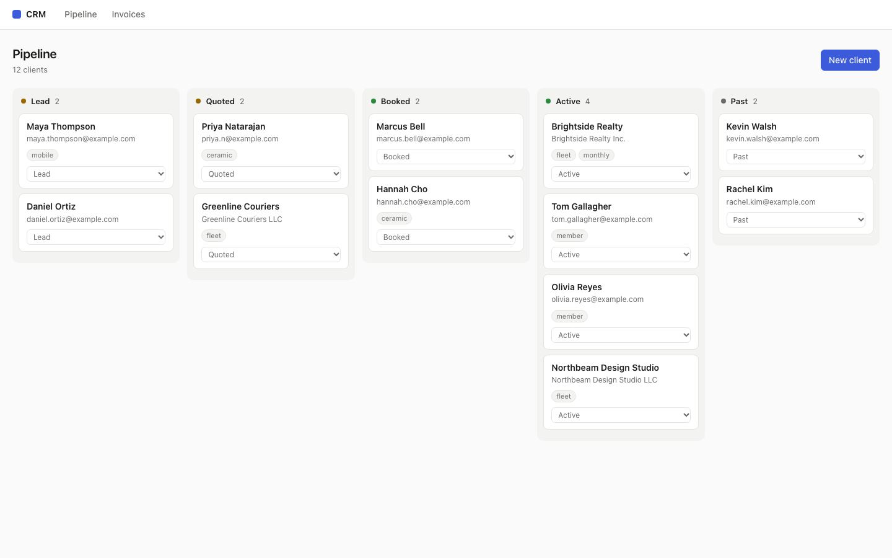
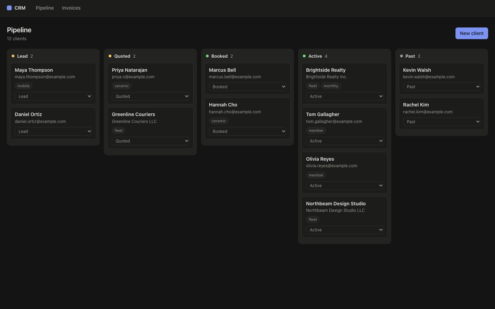
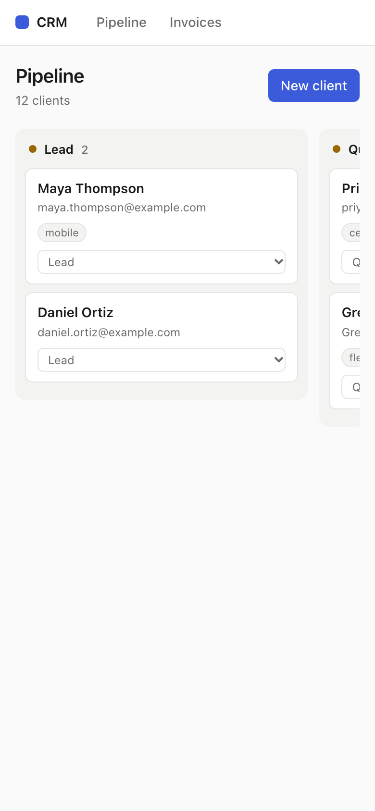

# CRM starter

A small CRM built with Next.js. It uses [Workspace369](https://workspace369.com/) as the backend, over MCP. Your clients, proposals and invoices live in Workspace369. This app is a front end for them.

[](https://vercel.com/new/clone?repository-url=https%3A%2F%2Fgithub.com%2FWorkspace369-LLC%2Fcrm-starter&project-name=crm-starter&repository-name=crm-starter&env=W369_TOKEN%2CAPP_PASSWORD&envDescription=W369_TOKEN%3A+a+personal+access+token+from+Workspace369+%28Settings+%3E+AI+connections%3B+use+a+test+workspace+while+you+build%29.+APP_PASSWORD%3A+the+password+you+will+use+to+open+this+app.&envLink=https%3A%2F%2Fgithub.com%2FWorkspace369-LLC%2Fcrm-starter%23deploy)

Or choose **Use this template** on GitHub to start your own copy.



| Dark | Phone |
|---|---|
|  |  |

## What it can do

- Pipeline board: one column per stage in your workspace. Move a client between stages.
- Client page: see proposals and invoices, edit custom fields, and start a draft proposal.
- New client form with your custom fields.
- Invoices list.

It reads data and creates drafts. It never sends anything. Sending a proposal or invoice, or recording a payment, waits for approval in the Workspace369 app. If a write is held, the app shows "Awaiting approval in Workspace369." with a link.

Your token stays on the server. Only server code imports `lib/workspace369.ts` (it uses `server-only`), so the token never reaches the browser.

## Quick start with sample data

You do not need an account. A mock MCP server ships with the repo. It has a sample company, "Apex Auto Spa", with 12 clients, custom fields, proposals and invoices. State is in memory and resets on restart.

```sh
npm install
npm run mock   # http://localhost:4010/mcp
```

In a second terminal, create `.env.local`:

```sh
W369_TOKEN=mock-token
W369_MCP_URL=http://localhost:4010/mcp
```

Then run the app and open http://localhost:3000:

```sh
npm run dev
```

The mock accepts any non-empty token. To see the approval message, start it with `MOCK_HOLD_WRITES=1 npm run mock`. Every write then comes back as held.

## Use a real workspace

1. In Workspace369, go to Settings → AI connections and create a personal access token. Use a test workspace while you build.
2. Copy the example env file: `cp .env.example .env.local`.
3. Set `W369_TOKEN` in `.env.local`. Optionally set `W369_MCP_URL`. It defaults to `https://mcp.workspace369.com/mcp`.
4. Run `npm install && npm run dev`.

## Deploy

Use the **Deploy with Vercel** button at the top. It copies this repo to your GitHub account and asks for two values:

- `W369_TOKEN`: your personal access token. It stays a server-side environment variable.
- `APP_PASSWORD`: the password for opening the app. Your browser asks for it once; any user name works.

The token can read and change your clients, so a deployed copy always needs the password. Without `APP_PASSWORD`, the deployed app serves nothing (it shows a "Set APP_PASSWORD" message). Locally, `npm run dev` stays open when `APP_PASSWORD` is unset. The check is in `middleware.ts` and `lib/gate.ts`.

Never prefix the token with `NEXT_PUBLIC_`. Never commit `.env.local`. It is already in `.gitignore`.

Writes change real records and can start workflows. Try them in a test workspace first.

## Tools the app calls

`clients_search`, `clients_get`, `clients_create`, `clients_update`, `clients_move_stage`, `workspace_schema`, `proposals_search`, `proposals_create_draft`, `invoices_search`.

Your workspace may offer newer schemas. List them with:

```sh
curl -s https://mcp.workspace369.com/mcp \
  -H "Authorization: Bearer $W369_TOKEN" \
  -H "Content-Type: application/json" \
  -H "Accept: application/json, text/event-stream" \
  -d '{"jsonrpc":"2.0","id":1,"method":"tools/list"}'
```

Each page reads `tools/list` and only shows a feature when the server offers it. The stage board needs `clients_move_stage`. The custom field forms need a `custom_fields` argument on `clients_create` and `clients_update`. Older servers still work with fewer features.

## Scripts

```sh
npm run dev        # start the app
npm run mock       # start the mock MCP server
npm test           # unit tests (mocked fetch)
npm run typecheck  # TypeScript check
npm run build      # production build
```

## Project structure

```
app/               Next.js pages, forms and server actions
lib/workspace369.ts  MCP client (JSON-RPC over HTTPS, server-only)
lib/crm.ts         CRM helpers built on the client: clients, stages, proposals, invoices
scripts/mock-mcp-server.mjs  Mock MCP server with sample data
test/              Unit tests
AGENTS.md          Rules for AI coding agents working in this repo
```

## Build on it with an AI coding agent

`AGENTS.md` tells coding agents how to extend this app safely: all data goes through Workspace369, drafts only, token stays on the server. Point your agent at this repo and ask for a feature. See the guide: [Build a custom CRM with an AI coding agent](https://docs.workspace369.com/v/2026.3/build-with-ai/build-a-custom-crm-with-an-ai-coding-agent/).

## Links

- [Workspace369](https://workspace369.com/)
- [Build a custom CRM with an AI coding agent](https://docs.workspace369.com/v/2026.3/build-with-ai/build-a-custom-crm-with-an-ai-coding-agent/)
- [Workspace369 MCP on GitHub](https://github.com/Workspace369-LLC/workspace369-mcp)

## License

MIT. See [LICENSE](LICENSE).
